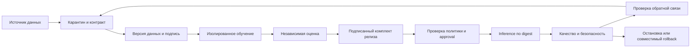

# Trusted MLSecOps Platform

Исследование и реализация воспроизводимого жизненного цикла машинного обучения с контролями безопасности.

**Сквозной запуск:** [одна команда, refusal path и восстановление той же модели](docs/operations/r1-walkthrough.md). Реализована интеграция существующих компонентов, native проверка ещё выполняется. Diagnostic inference не является approved release, M01-M23 не объявляются завершёнными.

**Поставка R1:** [замороженные границы, обязательные блокеры и 5 checkpoints](docs/r1-delivery.md). [Будущие улучшения FI-001-FI-008](docs/future-improvements.md) выполняются только после R1 и отдельной команды владельца. Дальнейший порядок определяется delivery-планом, а не количеством завершённых компонентов.

**CP1 gates приняты; следующий checkpoint CP2.** Native `ab00a4e`: M01 pass / 10 cases, M04 pass / 764, M05 pass / 58, M20 pass / 725, M21 pass / 122. При deadline/OOM training faults настоящий inference сохранил ответы и serving worker. [Успешный targeted CI](https://github.com/Abrakadabra124/trusted-mlsecops-platform/actions/runs/39464190902), [порядок приёмки](docs/r1-delivery.md), [ранбук](docs/kubernetes-lab.md#cp1-m04m05-и-отказ-training-при-настоящем-inference), [статус и сохранённые отказы полной матрицы](STATUS.md). Image/model blockers, отдельный privacy/output отказ и end-to-end R1 acceptance остаются открыты; выпуск запрещён.

Последний подтверждённый runtime checkpoint до CP1: **[native a7a09c8 verified](docs/evidence/audit-evidence-a7a09c8-native.md)**, 85 cases. [Private primary audit packet](docs/decisions/0049-private-audit-evidence.md), independent HTTP outcomes и parent verification после child exit: 107 responses, 336 audit events / 84 completed / 0 unresolved. Все 10 CI terminal: 6 success / 4 failure. [RED/review и ограничения](docs/evidence/audit-evidence-2026-10-20.md), [RB-68/PB-42](docs/operations/audit-evidence-troubleshooting.md). Полный M13 не принят, release blockers сохраняются.

T16 checkpoint: [fresh private receipt, native b0df48e](docs/evidence/privacy-evidence-b0df48e-native.md) - 83 cases, independent signed proposal binding, 340 audit events / 85 completed requests; 10 terminal CI: 6 success / 4 failure. [RB-67/PB-41](docs/operations/privacy-evidence-troubleshooting.md). Это проверенный компонент, не полный M13 или разрешение release.

T16: [наблюдение всего serving lifecycle](docs/decisions/0047-serving-output-observation.md) дополняет HTTP-проверку внешними stdout/stderr pipes, закрытием вложенных captures и публикацией только проверенного snapshot. **[Native 2a70ffc: 82 cases, zero stderr, 6 canaries](docs/evidence/serving-output-2a70ffc-native.md)**; Linux output/privacy probes 100%, CI 6 success / 4 failure. [История исправлений](docs/evidence/serving-output-2026-10-19.md), [карта каналов](docs/privacy-output-map.md), [RB-66/PB-40](docs/operations/serving-output-troubleshooting.md). Wrapper только disposable hosted CI; full M13/R1 и image/ML release blockers открыты.

T16: [приватная source-to-request корреляция](docs/operations/audit-correlation-troubleshooting.md) связывает signed data lineage, training metadata, evaluation и отдельное release approval либо qualification permit с запросом. Public API/export не раскрывают эту цепочку. **[Native 54cbe50: 64 tests / 100%, 81 actual-candidate case](docs/evidence/audit-correlation-54cbe50-native.md)**; все 10 CI terminal, 6 success / 4 failure. Image/ML failures сохраняют запрет release, полный M13/R1 не принят.

T16: [публичный экспорт закрытого audit journal](docs/operations/audit-export-troubleshooting.md) формирует только строгую сводку без request/principal IDs и private references. [Точный статус проверки](docs/evidence/audit-export-2026-10-19.md) отделяет Windows unit checks от Linux filesystem/CLI и actual-candidate evidence. Это не полная M13-приёмка и не release approval.

Новый increment: [локальный inference API](docs/serving-api.md) связывает [проверенный Reader](docs/decisions/0030-current-release-reader.md) с постоянным изолированным ONNX worker, before/after-inference trust checks, named features, body limits и явными отказами. Полная M12/R1 приёмка ещё не пройдена; positive native fixture не разрешает реальный candidate с failed gates. [PB-25/RB-48/RB-49](docs/operations/serving-troubleshooting.md), [evidence и ограничения](docs/evidence/serving-api-2026-10-14.md).

**Статус: R1 в разработке, первый рабочий developer preview.** Уже доступны синтетические данные, подписанные manifests, контейнерное обучение, ONNX-предсказания и отдельный scorer с подписанным evaluation report. Полная приёмка M01-M23 пока не пройдена: preview не является trusted release или production-платформой. Исследование: 2026-10-06; начало реализации: **2026-10-07**.

Перед оценкой обязателен [отдельный intake модели](docs/artifact-intake.md): проверка exact bytes в изолированном worker, защита от stale/partial scan и receipt в signed evaluation schema 2. **[M21 принят в clean-checkout CI: 122/122 cases](docs/evidence/intake-acceptance-2026-10-13.md)**, включая scoped Kubernetes replay, signed denials и независимый promoter readback. [PB-17/RB-35](docs/operations/scoped-intake-troubleshooting.md) описывает повторение, deadline/process failure и безопасную диагностику. Это synthetic lab gate, не release approval; image audit и poisoning blockers сохраняются.

## Запустить рабочий пример

Для испытания настоящего upstream candidate добавлен [PB-26](docs/operations/candidate-serving-troubleshooting.md): неизменённый signed proposal -> отдельный qualification permit -> isolated ONNX/HTTP -> source readback. **46/46 native cases pass в clean-checkout CI `e9120e0`**, первый 503 при trust outage через 59.995078784 s, проверенный recovery. [Evidence](docs/evidence/http-trust-outage-2026-10-15.md) сохраняет прежний late-denial failure и исправление cleanup. Один lab trace не гарантирует все network faults; полный M11/M12 открыт, permit не заменяет release approval.

Для promotion journal добавлен [явный backup v2 и независимый restore](docs/operations/promotion-recovery-troubleshooting.md): общий snapshot CAS/journal, внешний backup-id pin и maintenance при import. [Evidence и ограничения](docs/evidence/promotion-recovery-2026-10-14.md). Восстановленная БД не становится автоматически trusted serving.

Следующий T14 component - [отдельная online trust authority и lease](docs/operations/trust-troubleshooting.md): root-signed текущая policy, отзыв материалов/ключей, deadline максимум 60 s и проверка в SDK promotion. [Результаты и ограничения](docs/evidence/online-trust-2026-10-14.md). Endpoint integration и полная M11-приёмка ещё не завершены.

Проверенный T13 increment: [постоянный promotion journal](docs/promotion-ledger.md) и [PB-21/RB-40/RB-41](docs/operations/promotion-ledger-troubleshooting.md). Подписи проверяются до записи, конкурентный выбор сериализуется SQL-транзакцией; 108 native SQL checks pass в [CI evidence](docs/evidence/promotion-ledger-2026-10-14.md). Это ещё не serving activation; legacy backup с ledger запрещён, для совместного восстановления нужен явный v2 path. Установка явная, рабочий state автоматически не мигрируется.

Новый [release proposal и authorization contract](docs/release-authorization.md) связывает модель, dataset, lock, runtime, evidence и отдельное approval. [PB-20/RB-38/RB-39](docs/operations/release-authorization-troubleshooting.md) описывает отказ выпуска и восстановление interrupted publication. Это часть T13: active promotion/serving ещё не разрешены, release_ready=false.

Проверена [mitigation через robust training](docs/robust-training-protocol.md): качество сохранилось, но recall drop кандидата **5.22-6.22 п.п. при лимите 5 п.п.** на трёх фиксированных probes. [Evidence](docs/evidence/robust-training-2026-10-13.md) и [PB-19/RB-37](docs/operations/robust-training-troubleshooting.md) показывают результаты, причину source-lock отказа и воспроизводимые команды. Baseline не заменён, failure не скрыт.

Новый [evasion/domain-support протокол](docs/robustness-protocol.md): ограниченная атака внутри допустимых признаков и явный abstain вне synthetic support. Локальный эксперимент обнаружил **падение recall на 7.18 п.п. при лимите 5**, а не подтвердил устойчивость модели. [PB-18/RB-36](docs/operations/robustness-troubleshooting.md) описывает диагностику и следующие действия без ослабления policy. Full M09/release остаётся заблокирован.

Проверка устойчивости: [полная poisoning matrix 30+5](docs/poisoning-benchmark.md). Локальное исследование выявило 10 нарушений targeted threshold при 5% poisoning; CI не скрывает такой fail. Это исследовательский результат и release blocker, не заявление универсальной защиты.

Приёмка оценки: [M07, PB-07 и RB-13/14](docs/evaluation-gate.md). Единая свежая campaign проверяет leakage, signed material binding и постоянный бюджет holdout в отдельных owned SQL-лабораториях. Не заменяет остальные gates и не разрешает production release.

Качество и доверие к оценке: [frozen policy, интервалы и signed report](docs/frozen-evaluation.md). Недостаток данных теперь даёт `inconclusive`, а reader проверяет report против ожидаемого candidate. [PB-06/RB-11/12](docs/operations/evaluation-troubleshooting.md) описывают диагностику и повторную квалификацию.

Независимая оценка: [постоянный holdout budget и PB-05](docs/operations/holdout-budget.md). SQL scorer ограничивает число попыток до чтения контрольных labels; новый run ID или перезапуск не обнуляют ledger. Это компонент M07, не общая приёмка release.

Новое: [native reproducibility campaign](docs/reproducibility.md) с тремя повторениями, реальными seed/data/environment mutations и публикацией шести runs. [Ранбуки и плейбуки](docs/runbooks.md) описывают диагностику, встреченные проблемы и безопасное восстановление. Read-only tracking check: `uv run --locked python -m scripts.tracking_doctor`.

Общая приёмка воспроизводимости: [M06 и PB-04](docs/reproducibility-gate.md), `uv run --locked python -m mlsecops.acceptance --gate M06 --output .runtime/evidence/M06.json`. Gate запускает новые обучения и сверяет сохранённые материалы; один старый report с pass недостаточен.

**Release заблокирован:** native audit на `19c618c` обнаружил High/Critical package findings. [Проверенные результаты и triage](docs/evidence/container-audit-2026-10-08.md). Рабочее обучение не означает безопасный выпуск; scanner exceptions не добавлены.

Дополнительная проверка среды: [аудит worker/PostgreSQL images](docs/container-audit.md). SBOM generation и vulnerability scan имеют отдельные результаты; недоступная база не даёт ложный pass.

Исправления проверяются через [отдельные images-кандидаты](docs/image-candidates.md), без замены работающей БД или ослабления severity policy. [Проверенное сравнение на `d4b5514`](docs/evidence/image-candidates-2026-10-09.md): часть findings устранена, но candidates тоже fail, есть новые storage advisories. Это не разрешённый release.

[Candidate restore на `3b4aaa0`](docs/evidence/storage-candidate-2026-10-11.md) воспроизведён в чистом CI: 434 проверки, 1 000 golden predictions/error 0.0; baseline storage/developer regression прошла. [Инструкция самостоятельного повторения](docs/storage-candidate.md). Новый scan по свежей базе по-прежнему блокирует выпуск: candidate storage 3 Critical/88 High, worker 55 High. Совместимость не равна безопасности.

Требуются Git, uv и Docker Engine с Linux x86_64 containers. Bootstrap требует Python 3.12, Docker с минимум 2 CPU/6 GiB общей памяти и 8 GiB свободного диска. Свободную RAM для worker с лимитом 4 GiB проверяйте отдельно: capacity не означает доступный headroom. На Windows подходит Docker Desktop/WSL2 (Windows Subsystem for Linux 2).

```bash
git clone https://github.com/Abrakadabra124/trusted-mlsecops-platform.git
cd trusted-mlsecops-platform
uv sync --locked --python 3.12.15
uv run --locked python -m mlsecops build
uv run --locked python -m mlsecops demo --versioned-data
uv run --locked python -m mlsecops.qualification
```

Первая установка/сборка использует сеть; training/prediction workers работают без сети, host mounts и ключей. Состояние, модели и ключи сохраняются только в игнорируемой `.runtime/`. Повторный bootstrap сохраняет identities, обучение создаёт новый run. Demo выводит метрики и явно указывает `unapproved`; оно не меняет исходную DevSecOps-платформу.

Qualification запускает отрицательные сценарии и три fresh-process обучения. Полный отчёт: `.runtime/evidence/developer-qualification.json`. CLI приёмки для ещё не реализованных полных gates возвращает `inconclusive`, exit code 2. [Подробности реализации и ограничения](docs/implementation.md).

Постановка эксперимента: [dataset card](docs/dataset-card.md), [model card](docs/model-card.md). Метрики и ограничения должны читаться вместе.

[Постоянный local MLflow](docs/tracking-service.md) принимает metadata трёх настоящих offline обучений через verified HTTPS, хранит metadata/auth в отдельных PostgreSQL databases с mTLS и проверяет публикацию после restart. Локально и в clean-checkout CI прошли 54 native checks, 16 controlled boundary cases и 74 worker checks. Полный M06 ещё открыт, tracking не одобряет releases. Предыдущий [SQLite spike и его CI](docs/tracking-spike.md) сохранены как отдельное compatibility evidence.

## Kubernetes backend

Добавлен отдельный local cluster с Jobs, Cilium deny policies, admission restrictions и реальными identity/resource probes. Инструкции, требования к памяти, 52 локальные проверки и честные ограничения: [Kubernetes lab](docs/kubernetes-lab.md). Это следующий component increment, не завершённая M01-M23 приёмка.

[Private cluster storage](docs/private-cluster-storage.md) добавляет отдельную PostgreSQL с ClusterIP, mTLS, role-specific namespaces и persistence qualification. Это подготовка к изолированным controllers; host SQL demo не переключается автоматически на новый instance.

[Подписанная migration](docs/cluster-storage-migration.md) переносит snapshot dataset/model/evaluation history в этот instance: maintenance barrier, атомарный import, продолжение после сбоя и реальные role readers с 1 000 golden predictions. Полная qualification запускается один раз на пустом target; она не сбрасывает существующие данные.

[Scoped controllers](docs/scoped-controllers.md) запускают обучение и оценку из отдельных publisher/scorer Jobs с ограниченными Kubernetes и SQL identities. Model workers остаются без сети, токенов и ключей. Qualification проверяет настоящие API/TLS отказы и сохранённый signed evaluation. Runbook содержит путь из clean checkout и безопасное обновление image profile; полный M04 и R1 ещё не приняты.

[Prediction protocol v2](docs/prediction-protocol.md) связывает каждую строку ответа с одноразовым запросом и проверяет version, порядок, размеры и probabilities до подписи. Локально прошли 164 contract checks и 136 controller checks; [точное evidence](STATUS.md). Это не гарантия правильных scores от malicious worker и не persistent holdout query budget.

[Live worker boundary](docs/live-worker-boundary.md) проверяет доступ обоих worker identities к одновременно работающему scorer: реальные SQL/API endpoints, keys/tokens, holdout fixture и `/proc` соседнего процесса. Прошли 137 checks с положительными контрольными запросами и сохранением SQL history. Это один из компонентов M20, не самостоятельный R1 release.

[Исполняемый M20](docs/worker-authority-gate.md) объединяет эти components с настоящим signer/SQL и native fault injection. Локально и в [clean-checkout CI](https://github.com/Abrakadabra124/trusted-mlsecops-platform/actions/runs/37835470267) прошли **722 checks**: 19 повреждённых responses не подписываются и не публикуются, два положительных контроля сохраняются и независимо проверяются. Gate заново выполняет suites, проверяет общий subject binding и не читает прежний pass как разрешение. Точные measurements и ограничения: [STATUS](STATUS.md). Это не завершённый R1 release.

## Данные и проверяемый intake

`--versioned-data` связывает source lock, подписанное разрешение snapshot, quarantine, curator approval и lineage с training run. Реализованы M02 и [M03 integrity gate](docs/integrity-gate.md) для synthetic-only профиля. [Source/intake: команды, 44 проверки и ограничения](docs/data-lifecycle.md). DVC исследован, но не включён из-за неисправленной транзитивной уязвимости: [ADR 0005](docs/decisions/0005-data-lineage.md). Порог аудита не ослаблен.

## Role-isolated storage component

Добавлен отдельный PostgreSQL 18.6 с mTLS, шестью SQL identities, immutable-by-role objects и 367 component checks. Новый SQL pipeline действительно обучает/оценивает модель через publisher/scorer credentials; ещё 26 checks проверяют интеграцию и подмены. [Воспроизведение, матрица прав и ограничения](docs/storage-lab.md). M03 заново выполняет эти suites, 36 Linux tamper/path fixtures и 2 SQL integrity controls. Старый developer demo сохранён отдельно; opt-in controllers описаны выше, полный M04 ещё не принят.

[Backup/restore CLI](docs/storage-recovery.md) создаёт подписанную согласованную копию и восстанавливает новую БД без перезаписи исходной. Локально прошли 430 component checks и 1 000 golden predictions после восстановления. Полный M17, ежедневный RPO и serving readiness этим не заявляются.

## Зачем нужен проект

MLSecOps (Machine Learning Security Operations) в этом проекте означает включение безопасности в сбор данных, обучение, оценку, выпуск и эксплуатацию ML-системы. Это не просто применение искусственного интеллекта для поиска атак: защищается сама система машинного обучения.

Цель - уметь доказать, из каких данных и каким процессом получена модель, кто разрешил её выпуск, что именно работает сейчас и как безопасно остановить или откатить систему. Подписи и хеши дополняются независимой оценкой поведения: корректно подписанная модель всё равно может быть плохой или отравленной.

Исходная платформа: [enterprise-devsecops-platform](https://github.com/Abrakadabra124/enterprise-devsecops-platform). Её код и исторические доказательства проверены read-only; действующая инфраструктура в рамках исследования не менялась.

## С чего начать

| Вопрос | Документ |
| --- | --- |
| Какой результат строим и что считаем успехом? | [Цель и границы](GOAL.md) |
| Что такое MLSecOps и какие выводы дали источники? | [Исследование](docs/research.md) |
| Что изменилось в мировых практиках и что применимо к нам? | [Международный обзор 2026-10](docs/global-research-2026-10.md) |
| Какие рекомендации из CyberOrda и нового текста обоснованы? | [Критический разбор](docs/material-review.md) |
| Как исследование меняет требования проекта? | [8 решений и их проверяемые связи](docs/practice-adoption.md) |
| Как использованы PDF, схема и статья PT? | [Разбор материалов](docs/provided-materials.md) |
| Что уже есть в текущей платформе? | [Baseline и gap analysis](docs/baseline-gap.md) |
| Как выглядит продукт и путь пользователя? | [Карта продукта](docs/product-map.md) |
| Как соединены компоненты и границы доверия? | [Архитектура](docs/architecture.md) |
| От чего защищаемся и что останется риском? | [Модель угроз](docs/threat-model.md) |
| Какие инструменты нужны и почему не все сразу? | [Выбор технологий](docs/technology-decisions.md) |
| Какие измерения докажут работоспособность? | [23 критерия приёмки](docs/acceptance.md) |
| В каком порядке реализовывать? | [14-16 недель плюс резерв](tasks/plan.md), [29 задач](tasks/todo.md) |
| Что делать при отказе или компрометации? | [Проект эксплуатационных процедур](docs/runbooks.md) |
| Что проверено сейчас? | [Статус и пределы доказательств](STATUS.md) |
| Где первоисточники и определения? | [Реестр источников](docs/sources.md), [словарь](docs/glossary.md) |
| Что изменилось между редакциями? | [История изменений](CHANGELOG.md) |

## Целевая цепочка



ML-сценарий - **Release Risk Advisor**, консультативная оценка риска релиза. В preview используются только синтетические нормированные признаки. ML не разрешает публикацию и не отменяет детерминированные security gates. Работа с реальными метаданными CI остаётся будущим пилотом, а не существующей бизнес-системой.

Для проверки механики сначала используются синтетические данные. Их метрики не доказывают пользу на реальных релизах. Реальные данные, разметка, допустимые ошибки и их владельцы должны быть согласованы до пилота.

## Проверка этого репозитория

Требуется только Python 3.12 или новее, без сторонних пакетов:

```bash
python scripts/check_docs.py
```

Проверяются локальные Markdown-ссылки и якоря, обязательные документы, идентификаторы критериев/задач/источников и правила публикации. Дополнительно проверяется [машиночитаемый реестр решений](docs/research-decisions.json): известные источники, gates/tasks, существующие артефакты, owner, ограничения и research-only статус. GitHub Actions выполняет ту же команду. **Зелёный документационный CI не означает прохождение ML-приёмки.** Валидатор не проверяет истинность научных выводов, доступность внешних сайтов, криптографию или модель.

## Что добавило исследование R0.2

Изучены материалы Google, Microsoft, AWS, Anthropic, NVIDIA, OpenAI, Databricks и Hugging Face, а также отраслевые первоисточники. Реестр содержит 44 записи, включая предоставленные материалы и baseline evidence, не 44 независимых эксперимента. Это качественный обзор выбранных публикаций, не статистика всего рынка.

В design добавлены inventory graph с транзитивным отзывом, раздельные worker/controller полномочия, проверяемое покрытие artifact scanning, абсолютные poisoning budgets с независимыми challenges и security-event replay. ML/LLM output никогда не становится разрешением privileged action. Полное внедрение ещё впереди; начатый developer preview не закрывает все design decisions автоматически.

## Условия реализации

- Не переносить production-данные, секреты, приватные модели или персональные сведения в этот публичный репозиторий.
- Начать с совместимости, ресурсов и P0-долгов исходной платформы, а не с установки всего ML-стека.
- Версии и digest зависимостей выбирать на этапе реализации после проверки совместимости и уязвимостей. Документация `latest` не является lock-файлом.
- У каждой будущей проверки должны быть отрицательный сценарий, машинный результат, commit/digest входов и ограничения.
- «Доверенная» означает проверенные свойства в определённой модели угроз, а не обещание абсолютной безопасности или сертификации.

PDF пользователя и исходная иллюстрация не переопубликованы. Ссылки, атрибуция и ограничения использования приведены в [разборе материалов](docs/provided-materials.md). Mermaid-схемы здесь являются оригинальной архитектурой предлагаемого проекта.
